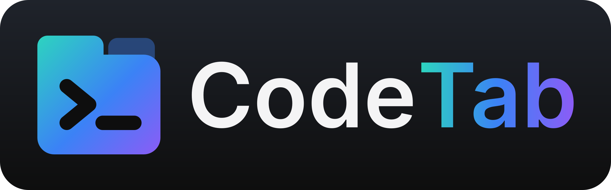
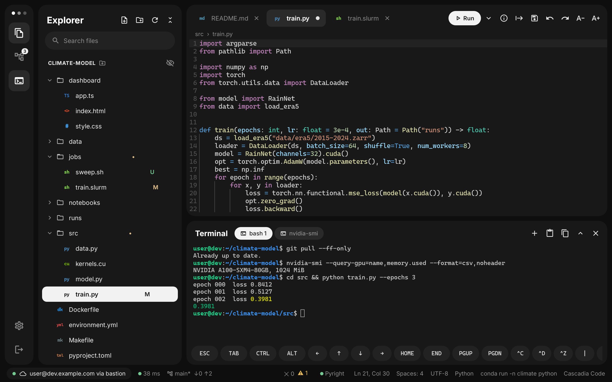
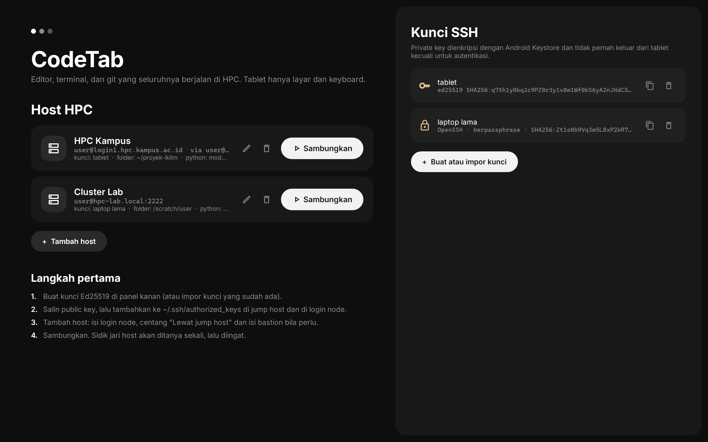
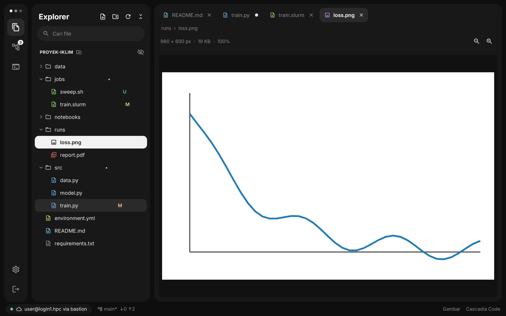

<p align="center">
  
</p>

<p align="center">
  <a href="https://github.com/aidsuu/CodeTab/actions/workflows/ci.yml"></a>
  <a href="https://github.com/aidsuu/CodeTab/releases/latest"></a>
  <a href="LICENSE"></a>
  
  <a href="https://trakteer.id/code_blank/tip"></a>
</p>

<p align="center">
  A code editor for Android tablets that works entirely on a remote server over SSH.
</p>

CodeTab turns a tablet into a window onto your remote machine. It gives you a file explorer, a code editor, a terminal, and a Git panel, while your code, builds, Python environments, and Git repositories stay on the server. The tablet only renders the interface and sends commands over SSH, so the server needs nothing beyond a standard SSH daemon with SFTP enabled.



## Features

- **SSH only.** Connect directly or through a single jump host. There is no code-server, agent, or daemon to install, and files are read and written over SFTP.
- **Key-based authentication.** Generate an Ed25519 key on the tablet or import an existing OpenSSH, PEM, or PuTTY key. Private keys are encrypted with a key held in the Android Keystore, and host keys are trusted on first use with a warning if they ever change.
- **Built for unreliable networks.** When the server has tmux, every terminal runs inside a tmux session, so shells and running programs keep going if the connection drops. CodeTab notices a lost connection within seconds, reconnects on its own with backoff or as soon as the device switches networks, and reattaches your terminals where you left them.
- **Responsive typing on slow links.** A latency indicator in the status bar shows the round trip to the server. When it is high, typed characters appear immediately and are confirmed once the server echoes them, similar to Mosh. Nothing is shown until the shell has echoed at least once, so password prompts stay hidden.
- **Explorer.** Browse a folder tree that loads on demand, search files, and see Git status at a glance. Each file shows a colored badge for its language. Create, rename, delete, and copy paths from a long press. Dotfiles are hidden by default and can be shown with one tap.
- **Code intelligence.** CodeTab runs language servers such as Pyright, clangd, gopls, and rust-analyzer on the remote machine and talks to them over SSH. You get completion that knows your installed libraries, errors and warnings as you type, documentation at the cursor, parameter hints, and go to definition. CodeTab finds installed servers on its own and suggests the install command when one is missing.
- **Editor.** Syntax highlighting for the [languages listed below](#supported-languages), line numbers, undo and redo, and adjustable font size. Before saving, CodeTab checks whether the file was changed on the server since you opened it, so a running job's output is never silently overwritten.
- **Image and PDF viewer.** Open plots, figures, and papers straight from the server with pinch to zoom.
- **Terminal.** A full `xterm-256color` shell with multiple tabs, 5,000 lines of scrollback, truecolor, support for full-screen programs such as vim, less, top, and tmux with mouse scrolling, an extra key row for Esc, Tab, Ctrl, Alt, and arrows, and safe multi-line paste.
- **Run.** Run the current Python or shell script in the terminal with one tap. On machines with SLURM, job scripts can be submitted with `sbatch`.
- **Git.** See the branch with ahead and behind counts, stage and unstage changes, discard edits, commit, pull, push, fetch, and view per-file diffs. Commands are compatible with Git 1.8 and newer.
- **Reconnect.** If the connection drops, open tabs and unsaved edits are kept, and a single tap reconnects.
- **Fonts.** Cascadia Code by default, with JetBrains Mono or the system font as alternatives. Ligatures are disabled, so code looks the way you typed it.

| Connect | Source control | Image viewer |
|---|---|---|
|  |  |  |

## Supported languages

The editor highlights about 60 languages using TextMate grammars from Visual Studio Code, plus community grammars for Kotlin and TOML.

| Area | Languages |
|---|---|
| Web | HTML, CSS, SCSS, Less, JavaScript, JSX, TypeScript, TSX, PHP, XML, XSL, Handlebars, Pug, CoffeeScript |
| Systems and apps | C, C++, CUDA C++, C#, Java, Kotlin, Groovy and Gradle, Go, Rust, Swift, Objective-C, Objective-C++, Dart, F#, Visual Basic |
| Scripting and data science | Python, R, Julia, Ruby, Perl, Lua, PowerShell, Batch, Shell (including `.slurm`, `.sbatch`, and `.pbs` job scripts), SQL |
| Data and configuration | JSON, JSON with Comments, JSON Lines, YAML, TOML, INI and `.properties`, `.env`, Dockerfile, Makefile, `.gitignore` |
| Documents | Markdown (with highlighted code blocks), LaTeX, TeX, BibTeX, reStructuredText, Diff, Log, Git commit and rebase messages |

Files are matched by extension and by well-known names such as `Dockerfile`, `Makefile`, `Gemfile`, `Jenkinsfile`, and `tsconfig.json`. Any other text file opens as plain text and can still be edited.

### Language servers

Completion, problems, hover, signature help, and go to definition come from a language server that runs on the remote machine, next to your code and its dependencies. CodeTab looks for the servers below in a login shell, so anything on your `PATH` works, as do common user folders such as `~/.local/bin`, `~/go/bin`, and `~/.cargo/bin`. Python servers use the interpreter set in the host profile, including Conda environments. When no server is installed, the status bar offers the install command, and the editor falls back to suggesting words from the open file.

| Languages | Servers, in order of preference |
|---|---|
| Python | Pyright, basedpyright, python-lsp-server, Jedi Language Server |
| C, C++, CUDA, Objective-C | clangd |
| Rust | rust-analyzer |
| Go | gopls |
| JavaScript, TypeScript, JSX, TSX | TypeScript 7 (`tsc --lsp`), typescript-language-server |
| HTML, CSS, SCSS, Less, JSON | vscode-langservers-extracted |
| PHP | Intelephense, Phpactor |
| Java | Eclipse JDT LS |
| Kotlin | Kotlin Language Server |
| C#, F# | csharp-ls, OmniSharp, FsAutoComplete |
| Ruby | Ruby LSP, Solargraph |
| R, Julia | languageserver, LanguageServer.jl |
| Shell, Dockerfile, YAML, TOML, Makefile | bash-language-server, dockerfile-language-server, yaml-language-server, Taplo, autotools-language-server |
| LaTeX, BibTeX, Markdown, reStructuredText | TexLab, Marksman, Esbonio |
| Lua, Perl, Dart, Swift, Clojure, SQL, XML | lua-language-server, Perl Navigator, Dart, SourceKit-LSP, clojure-lsp, sqls, LemMinX |

Any other server that speaks LSP over standard input and output can be used by entering its command in the language server dialog.

## Installation

Download the latest APK from [Releases](https://github.com/aidsuu/CodeTab/releases/latest) and install it on an arm64 Android tablet running Android 8.0 or newer. You may need to allow installs from unknown sources.

## Getting started

1. On the start screen, create a new Ed25519 key or import one you already use.
2. Copy the public key and add it to `~/.ssh/authorized_keys` on the server, and on the jump host if you use one.
3. Add a server with its host name, user, and key. If the server is only reachable through a bastion, enable the jump host option and fill in its details. You can also set a start folder such as `~/project` and the command used to run Python, for example `conda run -n env python`.
4. Tap **Connect** and confirm the host key fingerprint. CodeTab remembers it for future connections.

### Keyboard shortcuts

With a hardware keyboard attached, the following shortcuts are available.

| Shortcut | Action |
|---|---|
| `Ctrl+S` | Save the current file |
| `Ctrl+Space` | Show completions |
| `Ctrl+I` | Show documentation at the cursor |
| `F12` | Go to definition |
| `Ctrl+Enter` | Run the current file |
| `Ctrl+J` or `` Ctrl+` `` | Show or hide the terminal |
| `Ctrl+B` | Show or hide the sidebar |
| `Ctrl+W` | Close the current tab |
| `Ctrl+Shift+G` | Open source control |
| `Ctrl+=` / `Ctrl+-` | Increase or decrease the font size |

While the terminal has focus, all other `Ctrl` combinations are sent to the shell, so `Ctrl+C` and `Ctrl+D` work as expected.

## Architecture

```
Kotlin / Jetpack Compose (app/)          Rust (core/, libjangkau_core.so)
├─ Explorer, editor tabs (Sora Editor)   ├─ ssh.rs          russh, jump host, SFTP, exec, PTY
├─ TerminalView ─────────────────────────┤  term.rs         vt100 emulator and scrollback
├─ Git panel                             ├─ git.rs          git commands and porcelain parser
├─ Language services                     ├─ lsp.rs          LSP client over an SSH channel
├─ KeyVault (Android Keystore)           ├─ keys.rs         key generation and parsing
└─ AppState / WorkspaceState             ├─ known_hosts.rs  trust on first use
          ▲   UniFFI + JNA               ├─ keyenc.rs       key events to xterm bytes
          └──────────────────────────────┴─ paths.rs        POSIX paths and shell quoting
```

Everything that does not touch the screen lives in the Rust core, including SSH, SFTP, terminal emulation, the language server protocol, and Git command handling. The Kotlin app draws the interface and stores secrets in the Android Keystore. The two layers talk through bindings generated by UniFFI.

## Building from source

You need JDK 17 or newer, the Android SDK with NDK `27.2.12479018`, and a Rust toolchain with the `aarch64-linux-android` target.

```bash
rustup target add aarch64-linux-android
export ANDROID_HOME=/path/to/android-sdk
export ANDROID_NDK_HOME=$ANDROID_HOME/ndk/27.2.12479018
```

Build the Rust core for Android and for the host, and generate the Kotlin bindings.

```bash
scripts/build-core.sh
```

Then build the APK.

```bash
./gradlew assembleRelease
```

The bundled grammars can be refreshed from their pinned upstream versions with `scripts/update-grammars.py`.

The APK is written to `app/build/outputs/apk/release/`. Release builds are signed with the debug key so they can be installed directly. Sign with your own key before distributing a build.

### Running the tests

Run the Rust unit tests.

```bash
cargo test --lib --manifest-path core/Cargo.toml
```

Run the end-to-end tests against a real SSH server.

```bash
scripts/e2e-sshd.sh
```

Run the Android unit and screenshot tests.

```bash
./gradlew testDebugUnitTest
```

The end-to-end script starts an unprivileged `sshd` on a random local port with temporary keys. It covers the jump host, SFTP, remote commands, terminal resizing, a tmux session that survives a disconnect, a language server session, host key checks, and error handling, and it never touches your `~/.ssh`. With `CODETAB_LSP_REAL=1`, it also talks to every real language server installed on the machine. The Android tests load the host build of the Rust core through JNA and include Roborazzi screenshot tests on a 1280×800 dp landscape tablet. To update the screenshots, record them again.

```bash
./gradlew testDebugUnitTest --tests '*ScreenshotTest*' -Proborazzi.test.record=true
```

## Limitations

- Only arm64 builds are provided, so the app does not run on x86 emulators.
- Only public key authentication is supported. Passwords and keyboard-interactive two-factor authentication are not.
- Keeping terminals alive across disconnects requires tmux on the server. Without it, terminals fall back to a plain shell that ends when the connection drops. This can be turned off in Settings.
- `git push` and `git pull` rely on credentials already configured on the server, because remote commands run without an interactive prompt.
- Language servers run on the remote machine and must be installed there. Rename, formatting, and code actions are not supported yet.
- The editor opens files up to 4 MB. Larger files and binary files can be inspected in the terminal.

## Support the project

CodeTab is free and open source, and it is built and maintained by one developer. If it saves you time, you can support its development with a tip on [Trakteer](https://trakteer.id/code_blank/tip).

The next goal is an iOS version for iPhone and iPad. Building it means rewriting the interface in SwiftUI on top of the existing Rust core and paying for an Apple Developer Program membership to publish on the App Store. Every tip helps make that happen.

## Contributing

Contributions are welcome. Please read [CONTRIBUTING.md](CONTRIBUTING.md) before opening a pull request, and report security issues privately as described in [SECURITY.md](SECURITY.md).

## License

CodeTab is licensed under the [Apache License 2.0](LICENSE).

The bundled fonts Cascadia Code, JetBrains Mono, and Inter are licensed under the SIL Open Font License 1.1, and their license texts are in [`app/src/main/assets/licenses/`](app/src/main/assets/licenses/). The TextMate grammars in `app/src/main/assets/textmate/` come from Visual Studio Code, vscode-kotlin, and Taplo, all under the MIT License. Their license texts are also in `app/src/main/assets/licenses/`.
