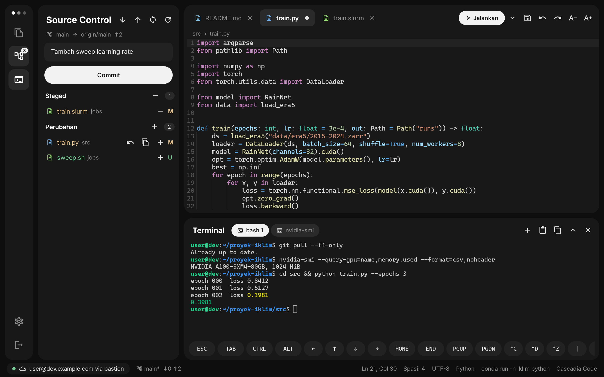

<p align="center">
  
</p>

<p align="center">
  <a href="https://github.com/aidsuu/CodeTab/actions/workflows/ci.yml"></a>
  <a href="LICENSE"></a>
  
</p>

A code editor for Android tablets that runs everything on a remote HPC cluster over SSH.

CodeTab gives you a file explorer, an editor, a terminal, and a Git panel. Python, jobs, Git, and every other process run on the cluster. The tablet only draws the interface and sends commands over SSH, so nothing needs to be installed on the server.


## Features

- **Pure SSH.** Connects directly or through one jump host (bastion) using `direct-tcpip`. No code-server or daemon on the cluster. Files are read and written over SFTP.
- **Key authentication.** Generate an Ed25519 key on the tablet or import an OpenSSH, PEM, or PuTTY key. Private keys are encrypted with AES-GCM using a key held in the Android Keystore. Host keys are trusted on first use and changes are flagged.
- **Explorer.** Lazy-loaded folder tree with file search, Git status markers, and create, rename, delete, and copy-path actions. Dotfiles are hidden by default and can be shown with one tap.
- **Editor.** Sora Editor with TextMate grammars for Python, Shell and SLURM, JSON, YAML, C, Markdown, and Diff. Before saving, CodeTab checks whether the file changed on the cluster since it was opened.
- **Image and PDF viewer.** PNG, JPEG, GIF, WebP, BMP, and PDF files open in a viewer with pinch zoom.
- **Terminal.** `xterm-256color` PTY with tabs, 5000 lines of scrollback, truecolor, alternate screen support for vim, less, and top, an extra key row, and bracketed paste.
- **Run.** Runs `.py` and `.sh` files in the terminal and submits `.slurm` and `.sbatch` files with `sbatch`.
- **Git.** Status with ahead and behind counts, stage, unstage, discard, commit, pull, push, fetch, and per-file diffs. Commands work with Git 1.8 and newer.
- **Reconnect.** When the connection drops, unsaved tabs are kept and one tap reconnects.
- **Fonts.** Cascadia Code by default, with JetBrains Mono or the system font as options. Ligatures are off.

| Connect | Source control | Image viewer |
|---|---|---|
|  |  |  |

## Install

Download the APK from [Releases](https://github.com/aidsuu/CodeTab/releases) and install it on an arm64 tablet running Android 8.0 or newer.

## Getting started

1. On the start screen, create a new Ed25519 key or import an existing one.
2. Add the public key to `~/.ssh/authorized_keys` on the jump host and on the login node.
3. Add a host with the login node, user, and key. Enable the jump host option if your cluster needs one. Optionally set a start folder such as `/scratch/user/project` and a Python command such as `module load python/3.11 && python`.
4. Connect and confirm the host key fingerprint.

### Keyboard shortcuts

| Shortcut | Action |
|---|---|
| `Ctrl+S` | Save |
| `Ctrl+Enter` | Run the current file |
| `Ctrl+J` or `` Ctrl+` `` | Toggle the terminal |
| `Ctrl+B` | Toggle the sidebar |
| `Ctrl+W` | Close tab |
| `Ctrl+Shift+G` | Source control |
| `Ctrl+=` / `Ctrl+-` | Font size |

When the terminal has focus, other `Ctrl` combinations go to the shell.

## Architecture

```
Kotlin / Jetpack Compose (app/)          Rust (core/, libjangkau_core.so)
├─ Explorer, editor tabs (Sora Editor)   ├─ ssh.rs          russh, jump host, SFTP, exec, PTY
├─ TerminalView ─────────────────────────┤  term.rs         vt100 emulator and scrollback
├─ Git panel                             ├─ git.rs          git commands and porcelain parser
├─ KeyVault (Android Keystore)           ├─ keys.rs         key generation and parsing
└─ AppState / WorkspaceState             ├─ known_hosts.rs  trust on first use
          ▲   UniFFI + JNA               ├─ keyenc.rs       key events to xterm bytes
          └──────────────────────────────┴─ paths.rs        POSIX paths and shell quoting
```

All non-UI logic lives in the Rust core. The Kotlin app draws the UI and stores secrets in the Android Keystore.

## Building from source

Requirements are JDK 17 or newer, the Android SDK with NDK `27.2.12479018`, and a Rust toolchain with the `aarch64-linux-android` target.

```bash
rustup target add aarch64-linux-android
export ANDROID_HOME=/path/to/android-sdk
export ANDROID_NDK_HOME=$ANDROID_HOME/ndk/27.2.12479018
```

Build the Rust core and generate the Kotlin bindings.

```bash
scripts/build-core.sh
```

Build the APK.

```bash
./gradlew assembleRelease
```

The APK is written to `app/build/outputs/apk/release/`. Release builds are signed with the debug key so they install directly. Use your own signing key for public distribution.

### Tests

```bash
cargo test --lib --manifest-path core/Cargo.toml
```

```bash
scripts/e2e-sshd.sh
```

```bash
./gradlew testDebugUnitTest
```

The end-to-end script starts an unprivileged `sshd` on a random local port with temporary keys and tests the jump host, SFTP, exec, PTY resize, host key checks, and error paths. It does not touch `~/.ssh`. The JVM tests load the host build of the Rust core through JNA and include Roborazzi screenshot tests on a 1280×800 dp landscape tablet. To update the screenshots, run the screenshot tests with recording enabled.

```bash
./gradlew testDebugUnitTest --tests '*ScreenshotTest*' -Proborazzi.test.record=true
```

## Limitations

- Builds target arm64-v8a only, so the app does not run on x86 emulators.
- Only public key authentication is supported. Passwords and keyboard-interactive 2FA are not.
- `git push` and `git pull` use credentials already set up on the cluster because exec sessions have no interactive prompt.
- The editor opens files up to 4 MB. Larger or binary files can be inspected in the terminal.

## Contributing

See [CONTRIBUTING.md](CONTRIBUTING.md). Please report security issues as described in [SECURITY.md](SECURITY.md).

## License

CodeTab is licensed under the [Apache License 2.0](LICENSE).

The bundled fonts Cascadia Code, JetBrains Mono, and Inter are licensed under the SIL Open Font License 1.1. Their license texts are in [`app/src/main/assets/licenses/`](app/src/main/assets/licenses/). The TextMate grammars in `app/src/main/assets/textmate/` come from Visual Studio Code and are licensed under the MIT License.
